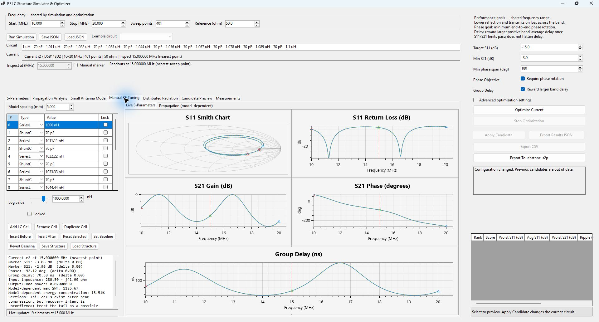
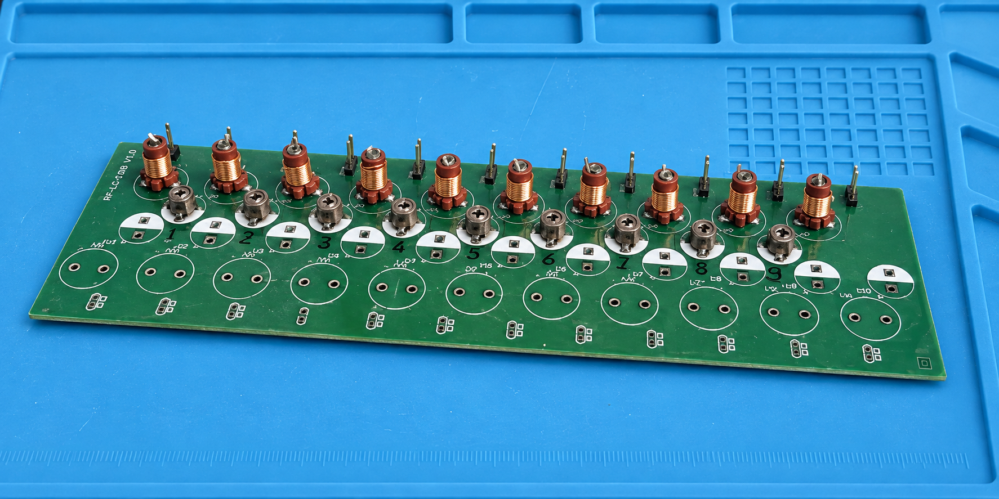

# RF LC Structure Simulator & Optimizer

A Windows desktop application and command-line toolkit for simulating, optimizing, and measuring RF networks built from cascaded inductors and capacitors. The project connects circuit calculations with physical board measurements and human-guided component adjustment using a NanoVNA-F V2.

The research objective is to obtain a large electrical length in a short physical structure: increased phase accumulation and reduced effective wavelength with controlled reflection, loss, and dispersion. The LC ladder is a one-dimensional electrical analogue of a future graded medium interacting with an electrically small radiator.

**Theoretical background.** This project is inspired by Arkadi Knyaz’s [*Isoimpedance Inhomogeneous Media*](https://aknyaz.com/pdf/media.pdf). We combine circuit simulation and physical LC prototypes to experimentally investigate slow-wave propagation, phase accumulation, and impedance matching. The current experiments examine these aspects through a one-dimensional circuit analogue; they do not yet validate the paper’s broader antenna or electromagnetic-force proposals.



*Desktop simulation of the [ten-coil, nine-capacitor example](board-10-cells-gentle-gradient-9%20capacitors.json) over 10–20 MHz. The live plots show transmission phase, group delay, reflection, and transmission magnitude. These are calculated model responses, not hardware measurements. To reproduce this view, load the example, select **Run Simulation**, and open **Manual RF Tuning → Live S-Parameters**.*

## Capabilities

- Calculate two-port S-parameters using cascaded ABCD matrices for series and shunt L, C, and R elements.
- Inspect transmission magnitude, unwrapped phase, group delay, and loaded LC-ladder voltage, current, phase, and stored energy.
- Edit component values interactively, compare against a baseline, and optimize candidate structures.
- Explore a small-antenna terminal load and terminal-coupling optimization.
- Save and load JSON configurations and export Touchstone S2P data.
- Import measured S2P files and compare them with a model snapshot evaluated at the measured frequencies.
- Acquire NanoVNA-F V2 measurements over a persistent serial connection and apply Saver software calibration.
- Exchange adjustment instructions and measurement results with an external assistant through a local guided-session file protocol.

## Build and run

Requirements: Windows and the .NET 8 SDK. The desktop application uses Windows Forms; both projects target `net8.0-windows`. NuGet restores OxyPlot.WindowsForms and System.IO.Ports during the build. RF hardware is optional for simulation and saved-file analysis.

Run these commands from the repository root:

```powershell
dotnet build RfSimulator.csproj
dotnet run --project RfSimulator.csproj
```

Alternatively, open `rf-simulator.sln` in Visual Studio with the .NET desktop development workload. The CLI is a separate project and can be built explicitly:

```powershell
dotnet build rf_sim_cli\rf_sim_cli.csproj
```

## First simulation and measurement comparison

1. Launch the desktop application and select **Load JSON**.
2. Load `board-10-cells-gentle-gradient-9 capacitors.json`, the model matching the ten-coil, nine-capacitor board topology.
3. Select **Run Simulation** and inspect the S-parameter and propagation plots. This model uses a 10–20 MHz sweep, ten inductors graded from 1.000 to 1.100 µH, and nine 70 pF capacitors.
4. In **Measurements**, use the measured-S2P import action, available through **Files / advanced**, to load `Saver measured 12.s2p`.
5. Select **Compare with current model snapshot**. Gold shows measurements; dashed blue shows the captured model. Select Compare again after changing the circuit.

The original `board-10-cells-gentle-gradient.json` has ten capacitors. Use the nine-capacitor file for the physical board comparison. Model values are calculation targets, not independently measured values of the adjusted components. Cell spacing affects spatial interpretation, not circuit S-parameters.

## Command-line use

The root launcher builds and runs the CLI through `dotnet run`:

```powershell
# Inspect a saved measurement without connecting to hardware.
.\rf_sim_cli.cmd --inspect-s2p "Saver measured 12.s2p"

# Analyze an example structure.
.\rf_sim_cli.cmd --input tests\small-antenna-best-structure1.json --mode compression --freq 27.5 --spacing-mm 5

# Run the regression fixtures and workflow checks.
.\rf_sim_cli.cmd --run-tests tests\cli
```

Analysis commands return exit code `0` when their pass flags pass and `2` when analysis completes but thresholds fail. See the [CLI guide](docs/rf_sim_cli.md) for optimization, incremental synthesis, refinement, and output formats.

## Physical tuning workflow



*The assembled prototype. AI-assisted retouching of the project photograph removes background clutter and improves framing; fine visual details may differ from the original. This image illustrates the hardware, while the archived measurement files document its measured response.*

Open the device and load the appropriate calibration in **Measurements**, then start a guided session. An external assistant submits one plain-text adjustment instruction to the displayed session folder. The operator makes the adjustment, removes the tool, and clicks **Done — measure**. The application acquires and saves the measurement; the assistant reads the result, compares it with the baseline and target, and chooses the next instruction.

The software does not move components. The protocol uses local files and requires an active result observer; it is not a built-in ChatGPT connection and does not wake an ended chat automatically. Generated root `tuning-*` folders are ignored by Git; selected experimental evidence is archived separately.

See [guided tuning](docs/guided_tuning.md), [NanoVNA acquisition](docs/nanovna_serial.md), and [Saver calibration](docs/saver_calibration.md) before a hardware session. Measurements use S11 and S21; exported S12 and S22 placeholders are not reverse-channel measurements.

## Measured results — 8 September 2026

The tested path contains **10 adjustable series coils and 9 shunt capacitors**, with Port 1 at TP1 and Port 2 at TP23. The reported active length is approximately **17 cm**.

The archived guided-tuning checkpoint gave a band-average delay of **96.29 ns**, compared with **91.66 ns** for the ideal model over the measured samples within 10–20 MHz: approximately **5.05% difference**. Agreement is strongest in phase slope and delay; measured transmission magnitude and loss differ from the ideal model.

A subsequent direct-reference comparison uses [measurement 11](Saver%20measured%2011.s2p) as the short reference and [measurement 12](Saver%20measured%2012.s2p) as the board measurement. Both contain 401 points from 5 to 50 MHz with the same software calibration applied. Recalculation gives:

| Quantity | Result |
|---|---:|
| Reference delay, 10.0625–19.9625 MHz | 1.392 ns |
| Board delay over the same band | 96.299 ns |
| Excess delay from board/reference S21 | **94.907 ns** |
| Excess phase change across that band | **−338.25°** |
| Board S11 at 5.5625 MHz | **−32.36 dB** |
| Board S21 at 5.5625 MHz | **−0.556 dB** |
| Local excess group delay at 5.5625 MHz | **136.645 ns** |

For 17 cm, the excess band-average delay corresponds to an effective group-delay factor of about **167**. The phase-compression estimate near 5.6 MHz is about **150**, conditional on the selected unwrapped phase branch; a sweep beginning at 5 MHz does not independently establish absolute phase accumulated from DC.

These results support substantial delay in a compact finite LC network. They do not establish a local homogeneous-material velocity, a measured dielectric permittivity, or antenna radiation efficiency. The direct-reference ratio is a useful normalization, not a full two-port fixture de-embedding; calibration residuals and mismatch remain relevant. Delay near deep transmission nulls is unreliable.

The current experimental direction is to preserve the adjusted board and acquire a finer **4.5–6.5 MHz** reference/board comparison with no-touch repeats before further tuning or antenna experiments.

## Documentation and evidence

| Document | Contents |
|---|---|
| [Measurement and direction update](docs/RF_PROJECT_MEASUREMENT_UPDATE_2026-09-08.md) | Reference comparison, operating windows, physical interpretation, and next measurements |
| [Detailed experiment report](docs/experiments/2026-09-08/report.md) | All 66 guided steps, adjustment procedure, metrics, screenshot, and archived evidence |
| [Measured S2P workflow](docs/measured_s2p.md) | Import, model snapshots, and phase/delay calculation |
| [Guided tuning protocol](docs/guided_tuning.md) | Session files, instruction submission, waiting, and result states |
| [NanoVNA serial acquisition](docs/nanovna_serial.md) | Device connection, segmented sweeps, and supported acquisition settings |
| [Saver calibration](docs/saver_calibration.md) | Software calibration workflow and assumptions |
| [CLI guide](docs/rf_sim_cli.md) | Analysis, optimization, synthesis, and regression commands |
| [Manual tuning consistency audit](docs/manual_tuning_consistency_audit.md) | Shared settings, candidate handling, and numerical checks |

The detailed tuning report describes the earlier checkpoint; the measurement update adds the later reference comparison and reported physical length. To regenerate the tuning report and its evidence manifest, run `python docs/build_tuning_report.py` with Python 3.

## Code layout

| Path | Purpose |
|---|---|
| `SimulationEngine.cs`, `RfMath.cs` | Network calculation and RF mathematics |
| `PropagationAnalysis.cs`, `SmallAntennaMode.cs` | Loaded-ladder and antenna-load analysis |
| `Optimizer.cs` | Candidate optimization |
| `CircuitWorkspace.cs`, `Models.cs`, `ProjectFiles.cs` | Circuit state and configuration persistence |
| `Form1*.cs`, `PlotFactory.cs` | Desktop controls and plots |
| `NanoVnaSerial.cs`, `SaverCalibration.cs` | Instrument acquisition and software correction |
| `TouchstoneImporter.cs`, `TouchstoneExporter.cs` | S-parameter file exchange |
| `TuningExchange.cs` | Local guided-session protocol |
| `rf_sim_cli/` | Command-line application and workflow regression checks |
| `tests/cli/` | Numerical regression fixtures |
| `docs/experiments/` | Experimental reports and preserved evidence |
