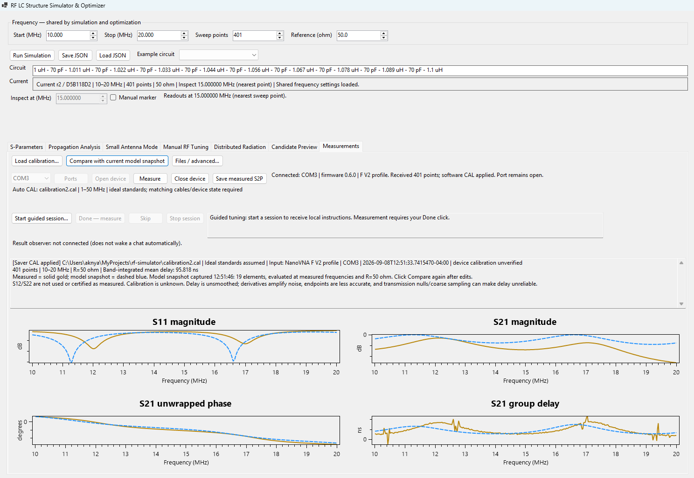

## Follow-up: corrected GUI model and dedicated 10–20 MHz measurement

The user supplied `board-10-cells-gentle-gradient-9 capacitors.json` and a screenshot saved at 12:52:06 on 8 September 2026. The screenshot was located in the user's Screenshots folder and visually verified against the attached image, then copied without image modification into the evidence archive.

The [updated user model](evidence/user-target-10L-9C.json) contains **10 series coils and 9 shunt capacitors** and is numerically identical to the corrected target used for this report. It retains 1.000–1.100 µH inductors and 70 pF capacitors. This follow-up corrects the GUI topology discrepancy noted for the earlier screenshot; it does not retrospectively change the archived tuning calculations.

The screenshot records:

- A dedicated **10–20 MHz, 401-point, 50 Ω** measurement acquired at **12:51:33 -04:00**.
- A model comparison snapshot captured at **12:51:46**, explicitly reporting **19 elements**.
- Software calibration `calibration2.cal` applied; measured traces are **solid gold**, model traces **dashed blue**.
- Displayed measured band-integrated mean delay: **95.818 ns**.
- Similar measured and calculated unwrapped S21 phase trends, with remaining differences in S11 minima, S21 magnitude, and group-delay peak shapes.

This is additional visual evidence of close phase/delay behavior with the correct physical topology. The displayed 95.818 ns is consistent with the earlier archived checkpoint's 96.285 ns, but these are different acquisitions on different frequency grids. The screenshot's measured delay is transcribed from the GUI, not independently recalculated from a saved S2P for this acquisition. It must not replace the original checkpoint values or be represented as exact point-by-point agreement. The underlying 12:51:33 sweep is not included in this addition; quantitative analysis of that specific acquisition would require its export.

The image and updated model are included in the evidence SHA-256 manifest. The earlier screenshot discussion remains historical context; this follow-up supplies a new, archived image with the topology corrected.
